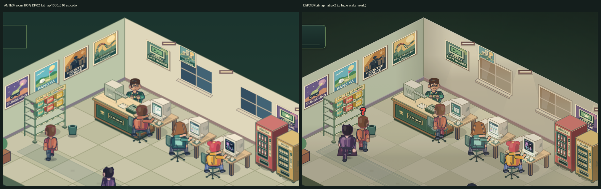
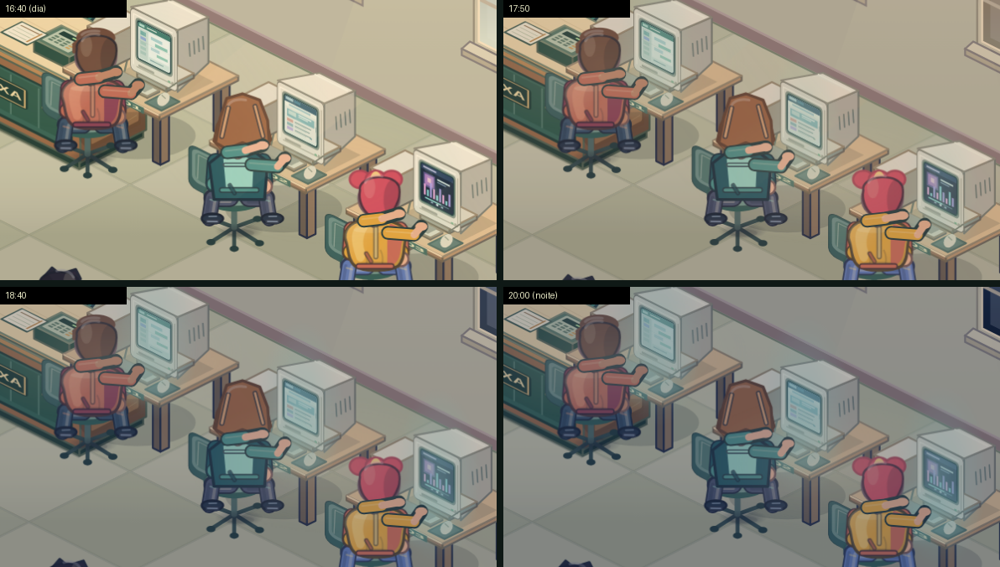
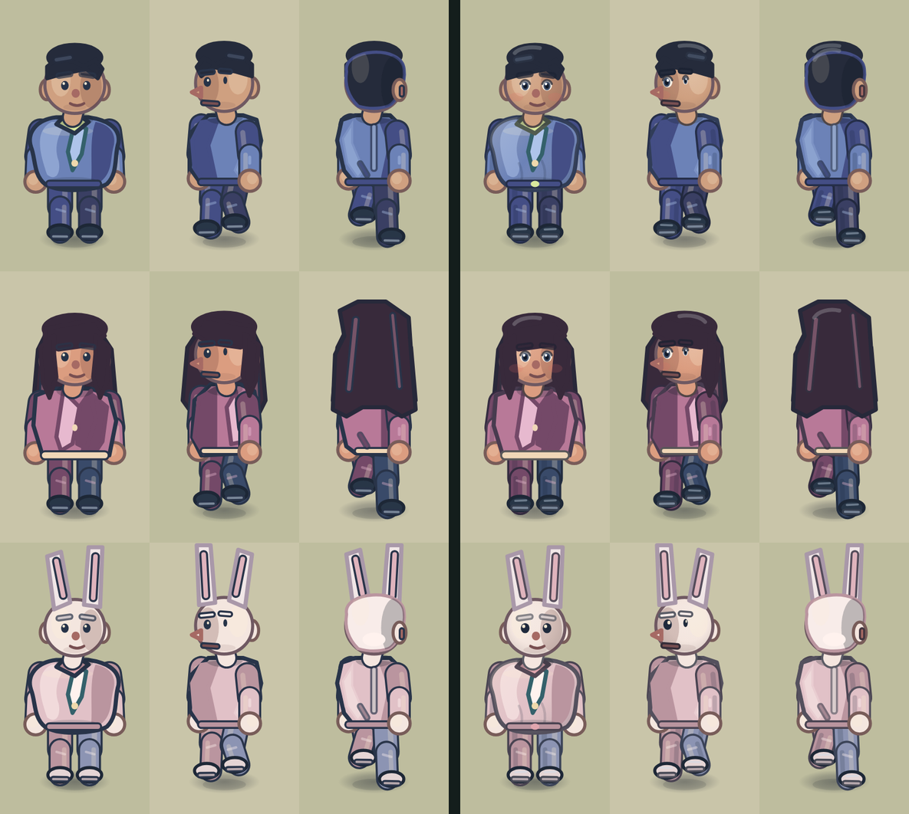

# Refatoração gráfica do salão — Canvas 2D procedural

Revisão geral da apresentação do Lan House Simulator, mantendo o contrato do
jogo: câmera 2:1 fixa, sem telhado nem exterior, simulação determinística que o
desenho apenas lê. Nenhuma posição, rota, âncora, footprint, colisão, preço,
RNG ou formato de save foi alterado. Toda a arte continua procedural, sem
imagens, fontes externas, WebGL ou dependências novas.



Capturas reais do Canvas em Chromium (as janelas diferem porque o “antes” foi
tirado às 17:30 simuladas, quando o código antigo ainda pintava vidro azul fixo).

## 1. Resolução nativa do dispositivo (HiDPI)

Antes, o Canvas tinha um bitmap fixo de 1000×610 esticado por CSS. Em telas
retina, no zoom do visor (até 3×) e em tela cheia, posters, textos e
personagens apareciam borrados.

- `src/render/sceneSurface.ts` define as **unidades lógicas** (`SCENE_WIDTH`,
  `SCENE_HEIGHT`) e calcula a escala do backing store a partir da largura CSS ×
  `devicePixelRatio`, quantizada em décimos (1000×610 unidades sempre caem em
  pixels inteiros), nunca abaixo de 1×, limitada a 3× em ponteiros finos, 2× em
  toque e a 6 Mpx por superfície.
- `createGameScene` ajusta o bitmap do salão e da prévia do menu antes de cada
  pintura. O contexto recebe `setTransform(escala)`; **nenhum pintor conhece a
  escala**: todos continuam desenhando em 1000×610.
- Picking (`scenePicking.ts`, `layoutEditor.ts`) e os rótulos noturnos usam as
  unidades lógicas, não `canvas.width`. Raios de toque continuam medidos em
  pixels CSS.
- `src/render/rasterCache.ts` unifica os três caches de bitmap (PCs, balcão,
  máquinas/prateleira). O raster é chaveado pela arte, pela escala e pela fase
  subpixel da âncora **em pixels do dispositivo**, por isso o blit reproduz a
  rasterização ao vivo em qualquer escala. O fundo estático usa a mesma regra.
- `actorSprites.ts` passa a escala ao Worker; `actorSpriteWorker.ts` rasteriza
  os quadros com `zoom = escala` e devolve a escala junto com o bitmap. O
  orçamento de 16 MiB cresce com escala² (máximo 4×). Contextos com transformação
  que não seja uma escala uniforme caem no artista vetorial.

## 2. Fundo cacheado: piso, paredes, janelas

- Piso com variação determinística de ±3% por ladrilho (`cellNoise`), aresta
  iluminada no canto superior, manchas raras de uso, oclusão ambiente nas bases
  das paredes e gradiente de profundidade (fundo iluminado, borda frontal mais
  escura). Faces da laje com gradiente vertical.
- Paredes com gradiente (luz das luminárias no alto), sombra do canto interno,
  filete claro no topo, rodapé em duas faixas e cones de luz abaixo de cada
  luminária (`drawLampHalo`).
- Janelas: moldura, recesso e peitoril em duas faces ficam no fundo; o **vidro
  é dinâmico** (`windowPanes`), com montantes e reflexo repintados por frame.
- Vinheta radial e leve brilho diagonal no fundo abstrato; tapete com borda
  costurada; capacho de fibra junto à soleira.
- Divisórias internas recebem gradiente e rodapé.

## 3. Luz por hora do dia (`src/render/lighting.ts`)

`daylightAt(totalMinutes)` deriva do relógio da simulação (10:00–22:00):

| Fase | Horário | Efeito |
| --- | --- | --- |
| `day` | 10:00–16:30 | vidro azul-céu, feixes suaves sob as janelas |
| `golden` | 16:30–18:20 | vidro âmbar, lavagem quente translúcida |
| `dusk` | 18:20–19:40 | transição contínua (smoothstep) |
| `night` | 19:40–22:00 | vidro escuro refletindo as lâmpadas, tinta azulada translúcida, poças de luz mais fortes |

**Monitores acendem ao anoitecer.** A sala escurece como descrito acima e, na mesma curva `night`, a tela de cada monitor ligado vai ficando mais clara e ganha um halo em volta (`monitorEmission` e `drawMonitorEmission`). A luz usa a cor da atividade real da estação (terminal, jogo, vídeo, navegador) e é mais forte numa sessão ocupada do que numa área de trabalho ociosa; monitor desligado ou em manutenção não emite. O retângulo do vidro vem do mesmo mapeamento de plano que desenha cada monitor (`monitorScreenQuad`: CRT e as cinco gerações de LCD, e nenhuma luz quando o vidro está de costas para a câmera). É pintada na ordem de profundidade, logo depois do sprite do PC e antes de quem está sentado, então o cliente continua tapando a tela. De dia não acrescenta nada; o ambiente escuro não foi alterado.



`drawSceneLighting` é pintado **depois dos objetos ordenados por profundidade e
antes** de marcadores, placa e HUD interno. Cada monitor ligado projeta um brilho
aditivo (`screenGlow`) sobre a mesa, com cor da atividade real da tela
(terminal, jogo, vídeo, LCD) e mais intenso à noite. Clima continua apenas no
HUD e na economia, conforme o contrato de visualização; o módulo não lê
`weather`, `Date.now` nem RNG.

## 4. Acabamentos

- Sombra de contato dos atores em gradiente radial (mesma elipse, mesmo
  ancoramento; sprites e vetor continuam idênticos).
- Pop-ups de pagamento com *pop-in* curto; balões de fala com cauda apontando
  para o cliente. Durações e filas inalteradas.
- Placa “LAN HOUSE” e contador de estações/clientes com cantos arredondados,
  sombra e bisel; textos e posições preservados.

## 5. Ciclo 2: personagens



Cada coluna é uma vista de tela (frente parado, frente-esquerda andando, costas-direita andando); à esquerda o ciclo 1, à direita o ciclo 2. Todos os 13 tipos (casuais, três femininos, dono, fantasias, animais, funcionários e carteiro) usam o mesmo rig e mantêm âncoras, poses, hitbox e paletas.

- **Contornos seletivos** (`edgeFor`): a linha de cada forma é uma versão escura da cor que ela envolve, em vez de um azul-marinho único. Fantasias claras (coelho, rato) deixam de ter aro escuro pesado; sobreposições translúcidas mantêm o traço padrão. Memoizado, sem custo por quadro.
- **Rosto com volume e vida:** pele em degradê radial com luz no alto à esquerda; olhos com esclera, íris por tipo, pupila, brilho fixo e linha de pálpebra (animais mantêm a conta preta brilhante); bochechas discretas nos personagens de rosto natural.
- **Cabelo:** reflexo claro na coroa, sempre dentro da silhueta, em casuais, dono, femininos e nas vistas de costas. A sombra da nuca segue a cor do cabelo e é mais leve em cabelo claro (some a meia-lua cinza do coelho e o anel azul das costas).
- **Forma:** luz de forma no tronco (peito claro, parte inferior direita sombreada), duas dobras de tecido na cintura, fivela, sombra de núcleo no lado oposto à luz em braços e pernas, punhos sombreados e reflexo no bico dos sapatos.
- **Sem custo novo no cache:** nenhum quadro depende do tempo de parede ou de aleatoriedade, então o Worker continua reaproveitando os mesmos quadros por pose, direção e fase (32 por ciclo). Piscar foi deliberadamente deixado de fora pelo mesmo motivo.

Verificação: `tests/actor-art-polish.test.mjs` (contornos, 13 tipos × 10 poses × 9 vistas sem erro e com coordenadas finitas, determinismo das chamadas, sem imagens ou aleatoriedade, olhos de pessoas vs. animais, paleta/identidade/hitbox inalterados) e `scripts/verify_actor_sprites.mjs`: erro médio máximo contra o artista vetorial caiu de 11,1 para 9,9 (limite 14) e nenhum pixel opaco faltou.

## 6. Desempenho

Medido em Chromium headless **sem aceleração por GPU** (pior caso: toda a composição é por software), cena de teste com dono, um cliente sentado e um andando às 17:30 simuladas, ms por quadro de `SceneRenderer.draw`:

| Versão | 1× | 1,1× (tela 1440 px, DPR 1) | 2× (retina) |
| --- | ---: | ---: | ---: |
| Antes do refator (só existe em 1×; em outras escalas o código antigo não usava cache) | 2,2 | n/a | n/a |
| Primeira versão desta refatoração | 6,2 | 6,0 | 15 |
| Atual | 3,8 | 4,9 | 9,5 |

A primeira versão custava muito por dois motivos, medidos por decomposição (desligando cada peça):

- **Modos de mistura sobre o quadro inteiro** (`lighter`, `multiply`, `soft-light`) a cada frame: cerca de 2,3 ms em 1× e 7 ms em 2×. Trocar de modo de mistura força o navegador a esvaziar o lote de desenho. A luz localizada (feixes e poças) agora é renderizada numa camada em cache, por hora quantizada em 24 passos, e composta com mistura normal; as lavagens de cor são `source-over`. Limitar a lavagem ao retângulo do salão foi tentado e descartado: tingia o fundo dentro do retângulo e deixava uma caixa visível à noite, sem ganho mensurável.
- **`shadowBlur` na placa e no contador** repintados todo quadro, contra uma convenção já registrada no projeto (aquário RGB: "sem shadowBlur, custo baixo no Android"). Trocado por sombras em camadas translúcidas.

O custo em 1× continua cerca de 1,6 ms acima do original (janelas dinâmicas, brilho dos monitores, capacho, gradientes) e cresce com a área em pixels. Em navegadores com canvas acelerado por GPU a diferença tende a ser bem menor, mas isso **não foi medido em aparelho físico**. Os limites de escala (3×, 2× em toque, 6 Mpx), o cache do fundo e dos móveis e o teto de 30 desenhos/s em toque seguem valendo. `tests/scene-lighting.test.mjs` impede a volta de modos de mistura e `shadowBlur` nesse caminho.

## 7. Verificação

```sh
npm test                                     # inclui scene-surface, scene-lighting e actor-art-polish
npm run typecheck
node scripts/verify_rendering.mjs out/perf   # fundo cacheado = pintura direta (0 px)
node scripts/verify_actor_sprites.mjs        # sprites = artista vetorial
node scripts/capture_scene.mjs out/validation
```

Comparações executadas nesta revisão em Chromium headless: fundo cacheado vs.
direto com zero pixels alterados em 1× e em 2,2×; caches de balcão, máquinas e
prateleira exatos em 2,2×; cache dos PCs com no máximo 24 pixels de diferença
(delta ≤ 8), igual ao comportamento anterior em 1×; 288 combinações de sprites
dentro do limite do script. As capturas são de arte procedural em revisão, não
de assets aprovados.

## 8. Limites conhecidos

- Em aparelhos com `devicePixelRatio` 3 e zoom alto do visor o bitmap pode ser
  reduzido pelos limites acima; a imagem continua mais nítida que 1×.
- Navegadores sem `OffscreenCanvas`/Worker usam o artista vetorial dos
  personagens em qualquer escala.
- A luz não reage a clima, eventos ou cosméticos; isso é decisão de contrato,
  não limitação técnica.
- Os scripts de captura e verificação (`capture_scene.mjs`, `verify_mobile_furniture.mjs`) convertem
  coordenadas pelas unidades lógicas 1000×610, não por `canvas.width`.
