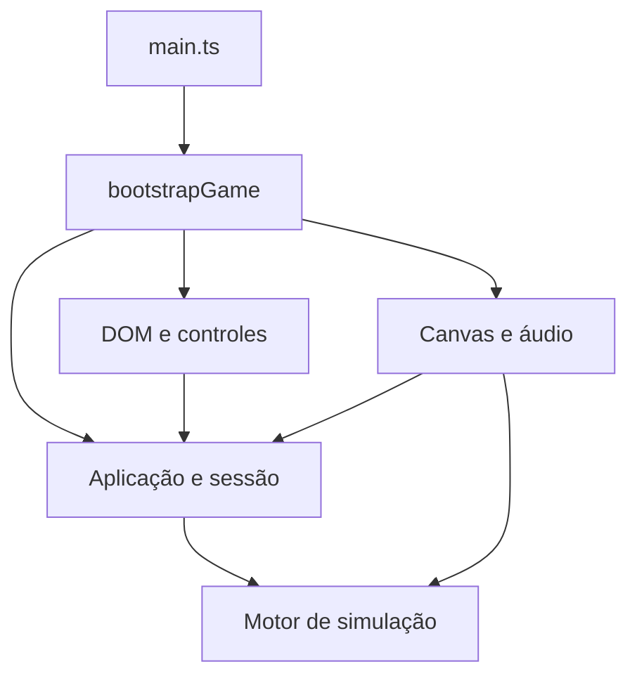

# Arquitetura do Lan House Simulator

Esta é a arquitetura consolidada após a revisão da `main` em `b73c5aa` (recorte 78). Substitui o histórico incremental desta página. O histórico dos recortes continua disponível no Git.

## Responsabilidades e dependências

| Camada | Responsabilidade | Dependências permitidas |
| --- | --- | --- |
| `sim/` | Estado, relógio, economia, clientes, filas, serviços, eventos, colisões e validação de saves | Somente outros módulos de `sim/`; bibliotecas padrão sem navegador |
| `application/` | Casos de uso, consultas tipadas, comandos validados, sessão ativa e coordenação da simulação | `sim/` e outros contratos de aplicação |
| `ui/` | DOM, abas, seleção, gestos, janelas, estado visual e atualização seletiva | Contratos de aplicação; projeção pura e contratos do adaptador Canvas quando necessários |
| `render/` | Canvas 2D isométrico, câmera, sprites, interpolação, efeitos e sobreposições | Leitura da simulação, modelos de apresentação e projeção; nenhum controle de tempo do motor |
| `audio/` | Reprodução e mistura dos efeitos autorizados | APIs de áudio do navegador; eventos recebidos por portas |
| `bootstrap/` | Composição dos adaptadores e capacidades do navegador | As camadas acima, sem implementar regras do jogo |
| `main.ts` | Importar e executar `bootstrapGame()` | Somente a composição |



O grafo de imports de runtime não contém ciclos. Imports apenas de tipos não introduzem dependências executáveis. Os testes inspecionam a AST de TypeScript, e a compilação `tsconfig.engine.json` cobre **motor e aplicação sem a biblioteca DOM**. Não há import de `sim/` nos componentes de `ui/`.

## Composição e posse do estado

`bootstrap/bootstrapGame.ts` valida os elementos por `ui/gameElements.ts`, monta armazenamento e preferência de som, cria a aplicação, a cena, os caches, o editor, os painéis, os controladores e o loop. `browserServices.ts` adapta Storage de forma tardia: até o getter de `localStorage` pode falhar sem impedir a recuperação prevista pela aplicação. A geração de entropia para uma nova campanha fica nessa borda.

`application/gameApplication.ts` é o único proprietário da instância ativa de `GameState`. `gamePorts.ts` monta uma única vez as portas existentes e as novas portas de hardware, encontro de sexta e HUD noturno. Todas recebem o **mesmo getter vivo `getState`**. A UI recebe `GamePorts`, não recebe esse getter nem a estrutura completa da partida.

Somente `render/gameScene.ts` recebe `renderSource`, para adaptar os renderizadores Canvas existentes. Esse acesso não pertence à API dos painéis e não permite avançar o relógio. O adaptador consulta a instância atual em cada captura/desenho.

`ui/runtimeUiState.ts` mantém, por sessão de navegador:

- Partida ativa ou menu e disponibilidade de save.
- Administração, loja, correio e aba ativa.
- Seleção de PC/GPU/monitor/hardware e posição de PS1.
- Colocação, giro, móveis em movimento, paredes, portas, PC anexo e prévias.
- Visibilidade do diagnóstico de circulação.

Nada desse estado visual é acrescentado ao save. O editor mantém seu rascunho local; `reset()` o descarta sem disparar uma ação ou salvamento.

## Sessão, persistência e troca de partida

`gameSessionPort.ts` continua usando os serializadores e as regras de backup já existentes em `sim/localSave.ts` e `sim/saveTransfer.ts`. As chaves `lhs-save-v1`, seu backup e a preferência independente `lhs.sound` não mudaram. O envelope de exportação e os campos persistidos não sofreram migração.

A substituição de partida segue esta ordem:

1. Validar e preparar a candidata sem aplicá-la; a UI pode pedir a confirmação existente.
2. Persistir a candidata com `sessionPort.replace`.
3. Trocar a referência ativa somente depois do sucesso da persistência.
4. Reinicializar o baseline de correio, os efeitos transitórios e as filas de popups.
5. Notificar os adaptadores com o motivo da troca, sem entregar `GameState` à UI.
6. Descartar rascunhos e prévias do editor, reiniciar seleções, interpolação, áudio de teclado e cache de circulação.

Importação local, restauração cloud e nova campanha usam esse mesmo caminho. Se o armazenamento falhar, referências, portas, eventos, UI e campanha anterior continuam intactos. `accountGamePort.ts` transporta saves opacos e comandos de cosméticos para a UI de conta; autenticação e transporte continuam no adaptador existente.

`runtimeSessionController.ts` cuida de menu, mensagens, arquivos e ciclo da página. Mantém autosave a cada 8 segundos, save imediato antes de voltar ao menu, `pagehide`, `beforeunload` e `visibilitychange`. Exportar, continuar e importar usam a partida atual. A preferência de som continua independente e tolera armazenamento bloqueado.

## Motor independente

As regras foram preservadas. A separação entre consultas geométricas e comandos rompe os ciclos antigos:

| Módulo puro | Conteúdo | Comandos mantidos em |
| --- | --- | --- |
| `direction.ts` | Direção no mundo, sem projeção Canvas | Movimento dos clientes/funcionários |
| `gameDefaults.ts` | Constantes iniciais compartilhadas | Criação da simulação |
| `eraCatalog.ts` | Anos, catálogo de eras/Windows e consultas de licença | `era.ts` |
| `stationLayout.ts` | Vagas, posições e limites dos PCs anexos | `stations.ts` |
| `serviceLayout.ts` | Posições e consultas de lixeiras | `services.ts` |
| `furnitureLayout.ts` | Vagas, posições, tipos e limites de decoração | `shop.ts` |
| `layoutGeometry.ts` | Objetos, footprints, colisões e consultas de colocação | `editableObjects.ts` |

`stationPower.ts` oferece a consulta de reparo; não precisa importar o serviço que inicia visitas. As APIs anteriores continuam exportadas pelos módulos de origem para os consumidores existentes. Consultas internas usam o módulo de estado/geometria, sem importar um barrel de comandos de volta.

O motor não conhece HTML, menus, som, Canvas, estrutura da página ou componentes. `createGame`, `stepGame` e os comandos podem executar em Node. As mesmas sementes de jogo e correio, o mesmo estado inicial e as mesmas ações produzem a mesma simulação. A data da exportação é metadado de arquivo, não relógio da partida.

## Administração e loja

Os módulos corretamente extraídos nos recortes anteriores foram reaproveitados. `ui/gamePanels.ts` somente coordena a apresentação e o cache; `runtimeControls.ts` instala as ações delegadas. As regras finais de preço, desbloqueio, capacidade, compra e débito continuam no motor.

| Área | Consultas e comandos de aplicação | Apresentação |
| --- | --- | --- |
| Finanças e clientes | `financialBalancePort`, `financialAdminOverviewPort`, `monthlyFinancePort`, `customerFeedbackSnapshot`, `promotionStatusPort` | `adminFinanceSections`, `financialBalancePanel`, `customerFeedbackPanel` |
| Preços e pacotes | `pricingPort`, `hourlyPriceStatusPort`, `retailPriceStatusPort`, `pricingInsightsPort`, `deskPricingPort` | `adminPricingSections`, `pricingControls`, painéis de preços |
| PCs e hardware | `stationActionsPort`, `pcOperationsPort`, `stationLedgerPort`, `hardwarePanelPort`, `lcdMonitorsPort` | `adminComputerSections`, `hardwarePanel`, `lcdMonitorsPanel`, `stationControls` |
| GPUs e licenças | `gpuCatalogPort`, `gpuGamesCatalogPort`, `gpuDownloadMetersPort`, `windowsLicensePort`, `classicGamesCatalogPort`, `basicGamesLicenseStatusPort`, `gameLicensingPort` | `adminGpuLicenseSections`, catálogos e controles de licenças |
| Serviços e funcionários | `serviceActionsPort`, `staffStatusPort`, `commerceNetworkPort`, `serviceAccessStatusPort` | `adminServicesConsoles`, `serviceControls`, diagnósticos |
| Estoque | `merchandisePort`, `retailPriceStatusPort` | `merchandisePanel`, fornecedores e preços |
| PS1 e CDs | `ps1ActionsPort`, `ps1AdminPort`, `ps1ShopDiscPort`, `ps1ShopOfferPort`, `ps1ShopPlacementPort` | `ps1AdminPanel`, `ps1Controls` e cartões da loja |
| Encontro de sexta | `fridayMeetupPort`, `nightTournamentHudPort`, `nightPresentation` | `fridayMeetupPanel`, `nightTournamentHud` e apresentação Canvas |
| Correio e histórico | `noticeActionsPort`, `noticeInboxPort`, `noticeWindowStatusPort`, `noticeInboxRevisionPort`, `eventLogPort` | `noticeControls`, `noticeWindowRefresh`, `eventLogRefresh` |
| Catálogo da loja | `shopActionsPort`, `shopCatalogOffersPort`, `shopServiceOffersPort`, `shopOverviewPort`, `shopCatalogRevisionPort` | `shopCatalogRefresh`, `shopCatalogRenderer`, cartões e categorias |

A UI de hardware agora recebe `HardwarePanelView`; fórmulas, cotações, permissões e texto de status são consultados pela aplicação. O painel de sexta recebe consultas/comandos estreitos. O HUD noturno recebe um DTO, sem navegar por torneios ou clientes no `GameState`.

`createPanelRevisionCache`, `adminPanelRevisionsPort`, `stationRevisionPort`, `syncPanelChildren` e o fluxo incremental da loja permanecem ativos. O render de frame não reconstrói todos os painéis. Controles e foco são preservados. Medidores de download e informações vivas mantêm seus caminhos seletivos. A normalização de preços legados continua explícita como comando de aplicação no mesmo ponto de compatibilidade anterior.

## Ordem do frame

`ui/runtimeLoop.ts` é o adaptador de RAF. Usa os coordenadores existentes, sem duplicar as políticas de frequência:

1. `frameSchedule.begin(timestamp)` limita `dt` a 0–0,08 segundo e acumula tempo visual.
2. Capturar a elegibilidade e a fração pendente da instância ativa.
3. `frameSimulationCoordinator.run`: resetar interpolação quando a elegibilidade muda; capturar posições **antes** do passo inteiro; avançar com `dt * 4.0`.
4. `gameFramePort.dispatch`: correio, pagamentos, vendas, impressão, teclado e falas, na ordem de `frameEventDispatch`.
5. `framePresentationCoordinator`: cena, diagnóstico de circulação, editor, prévia de menu, efeitos e prévias de colocação, na ordem de `frameVisualLayers`.
6. Atualizar o HUD se o gate de interação permitir.
7. Solicitar o próximo RAF. `start` é idempotente e `stop` cancela a solicitação pendente.

Menu, conta, edição e colocação continuam pausando a simulação conforme `frameActivity`. Abrir Administração não altera essa política. A distinção entre finalizar campanha e capturar movimento após o último minuto foi preservada.

A cena mobile continua limitada a 30 FPS; HUD exige mais de 450 ms, sem ponteiro mantido e respeitando 160 ms após scroll e 120 ms após entrada. Prévia de menu usa intervalo estrito superior a 90 ms e respeita redução de movimento. Aba oculta ou Canvas fora da viewport afetam a pintura, sem acelerar ou compensar artificialmente o relógio.

## Canvas e entrada mobile

`render/gameScene.ts` monta `SceneRenderer`, `SceneMotion`, a amostra ornamental de menu e os overlays. `render/scenePicking.ts` traduz coordenadas e seleciona vagas, móveis, paredes e PCs anexos; os handlers ficam em `ui/placementController.ts`. O editor consulta objetos e aplica comandos por `layoutEditorPort`.

Os desenhos, sprites, oclusão, câmera 2:1, pontos de ancoragem e regras de interpolação existentes foram mantidos. `render/direction.ts` continua expondo a API visual; a direção no mundo pertence ao motor. Helpers de apresentação noturna compartilhados agora pertencem à aplicação. Os exports antigos de prévia de menu e identidade de correio continuam disponíveis para compatibilidade.

Não foram alterados os limiares dos gestos: deslocamento superior a 10 px ou scroll superior a 3 px cancela toque no editor; click sintético é suprimido por 650 ms. O viewport continua distinguindo arrasto acima de 8 px e scroll acima de 3 px. Arrastar o mapa não compra nem move um objeto. Selecionar/destinar/confirmar pelo toque continua funcionando, inclusive após toque prolongado estacionário, giro e recarga de save.

## Verificação e extensão

```sh
npm ci
npm run build
npm run typecheck
npm test
npm run build:site
npm run check:site
```

`npm test` também compila motor/aplicação sem DOM. A configuração principal aplica `noUnusedLocals` e `noUnusedParameters`. Não foram adicionados frameworks nem dependências de produção.

- `simulation-foundation-boundary.test.mjs`: quatro campanhas de três dias com hash integral capturado em `b73c5aa`, sexto/sétimo PC, imports do motor e ausência de ciclos.
- `application-composition.test.mjs`: portas retidas após troca de save, atomicidade em falha de Storage, nuvem, transientes, anexos e consultas sem mutação.
- `runtime-composition.test.mjs`: ordem real dos coordenadores, cap de tempo, pausas, visibilidade/mobile, ponteiro mantido, bootstrap e Storage restrito.
- `remaining-panel-contracts.test.mjs`: DTOs de hardware, encontro/HUD noturno, restauração preparada e isolamento de todos os componentes DOM.
- Testes estruturais legados agora consultam o adaptador responsável e usam AST para ligações/ordem quando necessário; os testes funcionais existentes continuam ativos.
- `verify_layout_editor.mjs`: PC movido/girado, paredes, remoções, recarga e orientação, em 1440/414/360 px.
- `verify_mobile_interface.mjs`: scroll nativo, controle estável, áudio e ausência de pintura escondida em desktop/mobile, com CPU 4× mais lenta nos celulares emulados.
- `verify_save_on_menu.mjs`, `verify_hardware_ui.mjs` e `verify_integrated_engine_campaign.mjs`: save imediato, hardware de 2000/2024 e campanha real de 35 dias.

O workflow existente `Lan House Simulator - worker pool` valida simulação, site, Canvas, painéis, touch e Forge no PR. As nove auditorias extensas opcionais da suíte padrão permanecem condicionadas às flags já existentes; isso não é falha nem substitui os testes obrigatórios. Os resultados e limites desta entrega estão em [architecture-refactor-report.md](architecture-refactor-report.md).

Testes em Chromium com viewport mobile não equivalem a aprovação em aparelho físico. Aprovação artística, balanceamento de campanhas opcionais e serviços online autenticados continuam sujeitos aos respectivos fluxos próprios; não houve mudança de infraestrutura para esta refatoração.
